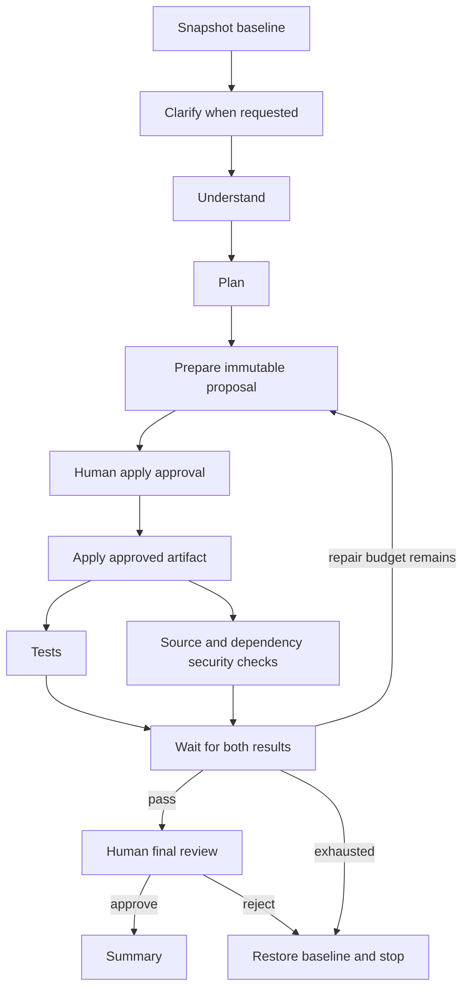

# Current architecture

The implementation uses a fixed Temporal lifecycle with versioned requirements and explicit gates:

Requirement changes are accepted through version-checked Updates. They invalidate approvals and checks, wait for active Activities to finish, restore applied files, and return to planning under a new requirement version. All upstream-dependent stages are rerun in V1; selective subgraph scheduling is deferred.

Each Activity uses a named operation dispatcher. The workflow enforces order, joins, repair budgets, deadlines, and gates. Immutable proposals, snapshots, and applied files live outside Temporal history. The workflow records references, hashes, structured decisions, and counters. Shortener HTTP requests are separate from the engineering workflow.

Read [Workflow controls](workflow-controls.md) for exact command examples, metric definitions, recovery behavior, trust boundaries, and remaining limitations. The default agent remains a demo adapter. The optional Claude Agent SDK provider generates schema-validated file proposals with explicit context transfer; see claude.md. The scaffold shortener routes remain placeholders. Docker execution passed in both live demonstrations; Claude approval signatures are verified by an Activity against the worker trust file; production Temporal endpoint authorization remains outstanding.

## Local files

`ARTIFACT_ROOT/<workspace_id>/proposals` retains candidates. `snapshots` retains the baseline for each requirement version. `workspace` contains current applied files. The run identity includes the Temporal run ID, so separate executions do not share mutable workspaces. Workers for the same execution must share the artifact root.

## Compatibility

Workflow changes can alter command history and Activity definitions. Start fresh development runs rather than replaying histories from the initial scaffold. Production worker versioning is future work.

## References

- https://docs.temporal.io/develop/python
- https://docs.temporal.io/develop/python/workflows/message-passing
- https://docs.temporal.io/develop/python/best-practices/testing-suite
