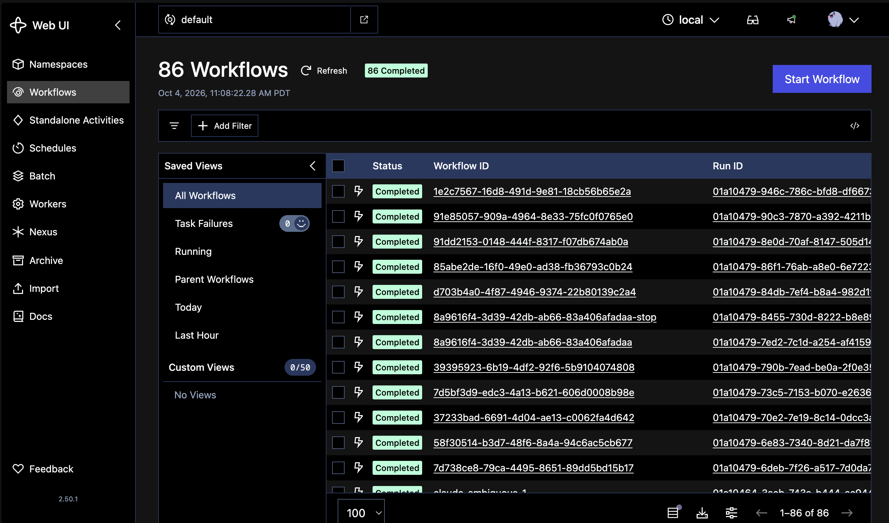
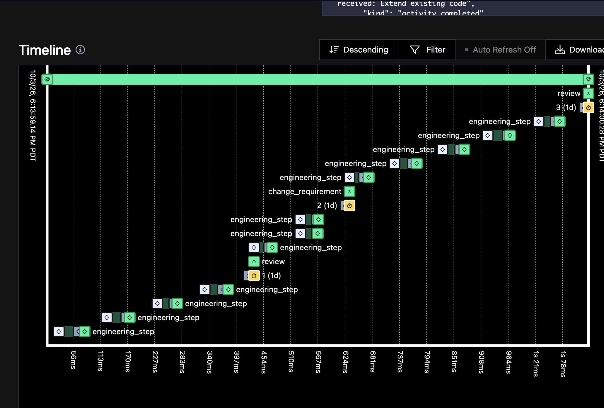
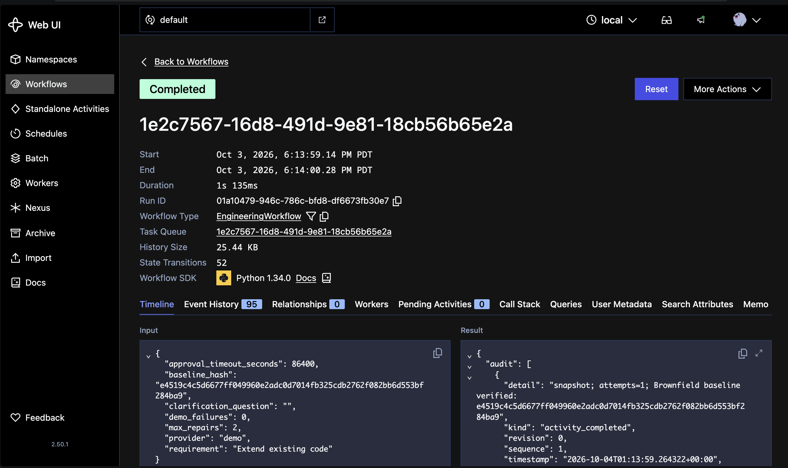

# Temporal screenshots

Original screenshots supplied by the author, included without image edits. They illustrate the local Temporal UI and orchestration behavior. The detailed run shown uses `provider: demo`; these screenshots do not establish Claude-generated application test or security results.

## Workflow overview

The local namespace shows 86 completed Temporal executions, including test and demonstration runs. This count is not the number of submitted scenarios or passing application tests. A Temporal execution can complete with an application-level stopped outcome; consult each report for the engineering result.

## Requirement-change timeline

The timeline shows `engineering_step` Activities, `review` updates, and a `change_requirement` update, followed by further Activities. The screenshot illustrates control flow; it does not expose the contents of every Activity or independently prove restoration correctness. The [live brownfield rollback verification](../brownfield/rollback-verification.json) records the restored file hashes.

## Completed demo execution

Workflow `1e2c7567-16d8-491d-9e81-18cb56b65e2a` is shown as completed, with type `EngineeringWorkflow`, 95 history events, and no pending Activities. Its input explicitly uses the demo provider and the requirement “Extend existing code.” This is supporting orchestration evidence.

## Completed Claude scenario reports

- [Greenfield](../greenfield/report.json): 15 application tests passed.
- [Brownfield](../brownfield/report.json): final revision passed 36 tests; requirement changes and rollback recorded.
- [Ambiguous](../ambiguous/report.json): 15 tests passed, signed approvals verified, and source/dependency security checks passed.
